# Forever RPG — SQL Server DBA 실습

> **SQL Server 데이터베이스 설계·트랜잭션·인덱스·운영 실습과 실제 웹 게임 연동**

Microsoft SQL Server로 RPG 게임의 데이터를 관리하고, 트랜잭션·조회 성능·장애 대응을 검증한 개인 DBA 실습 프로젝트입니다. AI를 활용해 FastAPI와 JavaScript 웹 게임을 구현한 뒤, 로컬 SQL Server에 실제로 연결해 구매·전투·보상 처리를 확인했습니다. 테스트에는 가상 게임 데이터를 사용했습니다.

## 주요 결과

| 항목 | 실습 결과 |
|---|---|
| 데이터베이스 설계 | V001: 7개 테이블·외래키 6개·CHECK 11개·UNIQUE 3개 / V003: 전투 테이블 추가로 총 8개 |
| 구매 처리 | V001 조회·구매 프로시저 3개 구현, 정상·실패 구매 검증 |
| 트랜잭션 | 골드 차감 후 강제 오류와 ROLLBACK 확인 |
| 인덱스 성능 | 최근 사냥 기록 20건 조회 시 논리적 읽기 449 → 3 (약 99.33% 감소) |
| 실행 계획 | 인덱스 힌트 없는 조회에서 Index Seek 확인 |
| DB 패치·복원 | V002 패치 재실행 검증, FULL 백업 및 별도 DB 복원 확인 |
| 장애 대응 | Blocking 재현 및 DMV 분석, 세션 92 → 78 대기(9,724ms), 해소 확인 |
| 교착 상태 분석 | 오류 1205 재현, Deadlock XML 분석, 희생자 SPID 75 및 키 잠금 순환 대기 확인 |
| 게임 전투 검증 | BattleId 1 승리(Won), 보상 완료 표시, 재공격 후 골드·사냥 기록 유지 |
| API 및 웹 게임 | AI를 활용한 FastAPI·JavaScript 구현, 로컬 DB 연결·구매·전투 실행 검증 |

> 성능 수치는 로컬 실습에서 얻은 결과입니다. 449와 3은 각각 강제 스캔과 복합 인덱스를 사용한 5회 측정의 평균이며, 실제 서비스 환경의 개선율을 의미하지 않습니다.

## 최종 포트폴리오 요약

[**Forever RPG 최종 통합 보고서**](docs/final_portfolio_summary.md)에서 기술 구성, 실측 성과, 게임 연동 흐름, AI 활용 범위, 검증하지 않은 항목을 한 번에 확인할 수 있습니다.

## 상세 실습 보고서

| 보고서 | 주요 내용 |
|---|---|
| [01. 데이터베이스 설계 및 제약조건 검증](docs/day01_database_design.md) | 테이블 관계, 제약조건, 초기 스키마 |
| [02. 저장 프로시저 및 트랜잭션 검증](docs/day02_transaction_test.md) | 구매 처리, 오류 발생, ROLLBACK |
| [03. 인덱스 및 쿼리 성능 분석](docs/day03_index_optimization.md) | 사냥 기록 약 10만 건, 실행 계획, 5회 측정 |
| [04. DB 패치 및 백업·복원 검증](docs/day04_patch_backup_restore.md) | V002 패치, 복원 이력, 원본·복원본 검증 |
| [05. Blocking 장애 재현 및 대응](docs/day05_blocking_troubleshooting.md) | 세션 간 잠금 대기, DMV 원인 분석, ROLLBACK 및 해소 검증 |
| [05. Deadlock 재현 및 XML 분석](docs/day05_deadlock_analysis.md) | 오류 1205, 희생자 선정, PK 키 잠금 순환 대기 검증 |
| [09. 전투 및 중복 보상 검증](docs/day09_battle_validation.md) | 전투 승리, 보상 완료 상태, 재공격 후 데이터 유지 |

## 사용 기술

**Microsoft SQL Server · SSMS · T-SQL · Git · GitHub**

게임 서버 및 로컬 웹 게임 구현: Python(FastAPI), pyodbc, HTML/CSS/JavaScript. **FastAPI·JavaScript `fetch()` 통신과 웹 화면 구현에는 AI를 활용**했으며, V003 전투 승리 및 순차 재공격 결과는 로컬에서 직접 검증했습니다.

실습 상세 내용과 SQL 실행 근거는 각 일차별 보고서 및 테스트 파일에서 확인할 수 있습니다.

성능 확인: `SET STATISTICS IO`, `SET STATISTICS TIME`, 실제 실행 계획  
동시성 제어: `UPDLOCK`, `HOLDLOCK`, `TRY/CATCH`, `XACT_STATE()`

## Forever RPG 웹 게임 실행 (로컬 개발 환경)

`backend/`에서 FastAPI와 게임 화면을 함께 실행합니다. Windows에 Python 및 Microsoft ODBC Driver 18 for SQL Server가 필요합니다.

```powershell
cd backend
python -m venv .venv
# PowerShell 가상환경 활성화가 막히면 실행 정책을 확인
.\.venv\Scripts\Activate.ps1
python -m pip install -r requirements.txt
Copy-Item .env.example .env
# .env의 DB_SERVER를 SSMS 연결 서버로 설정
uvicorn main:app --reload
```

- **게임 화면:** [http://127.0.0.1:8000/](http://127.0.0.1:8000/)
- DB 상태: [http://127.0.0.1:8000/health](http://127.0.0.1:8000/health)
- API 문서: [http://127.0.0.1:8000/docs](http://127.0.0.1:8000/docs)
- 캐릭터 조회: `GET /characters/{character_id}`
- 상점 조회: `GET /items`
- 인벤토리 조회: `GET /characters/{character_id}/inventory`
- 구매 처리: `POST /purchase` → `dbo.usp_PurchaseItem`
- 활성 몬스터: `GET /monsters`
- 최근 사냥 기록: `GET /characters/{character_id}/hunts`
- 전투 시작: `POST /battle/start` → `dbo.usp_StartBattle`
- 턴 공격: `POST /battle/attack` → `dbo.usp_AttackBattle`
- 진행 중인 전투: `GET /characters/{character_id}/battle`

상점에서 구매하면 SQL Server의 기존 저장 프로시저가 골드 차감, 인벤토리 지급, 구매 이력을 트랜잭션으로 처리합니다. 화면은 이후 캐릭터와 인벤토리 정보를 다시 조회합니다.

사냥터에서는 몬스터를 선택해 서버에서 관리하는 턴제 전투를 진행합니다. **V003 패치와 전투 프로시저 3개를 반드시 SSMS에 반영한 후** 웹 게임을 테스트하세요. 전투 상태는 `BattleEncounters`에 저장되며, 승리한 전투만 `usp_HuntMonster`를 통해 보상 골드와 `HuntHistory`를 한 번 기록합니다. 기존에 보상을 즉시 지급하던 `/hunt` API는 제거했습니다.

**적용 순서:** [V003 패치](database/migrations/V003__add_battle_encounters.sql) → [usp_HuntMonster 수정본](database/procedures/usp_HuntMonster.sql) → [usp_StartBattle](database/procedures/usp_StartBattle.sql) → [usp_AttackBattle](database/procedures/usp_AttackBattle.sql). 적용 뒤 FastAPI 서버를 다시 시작합니다. 기존 `06_hunt_validation.sql`의 무조건 사냥 EXEC 예시는 V003 이후 적용되지 않으므로 사용하지 마세요.

**주의:** 구매는 실제 개발 DB의 재화와 인벤토리를 변경합니다. 현재 웹 게임에는 로그인·권한 검사가 없으므로, 로컬 개발 환경에서만 실행하고 외부에 공개하지 않아야 합니다. `.env` 파일을 GitHub에 업로드하지 않습니다. 웹 화면 실행과 구매·사냥 및 전투 동작은 로컬에서 확인했지만, 외부 배포와 동시성 부하 테스트는 수행하지 않았습니다.

## 프로젝트 구성

```text
forever-rpg-mssql-dba/
├── backend/                    # AI 활용 FastAPI · SQL Server 연동 · 웹 게임
├── database/
│   ├── migrations/             # V001 ~ V003 스키마 패치
│   ├── procedures/             # 구매 · 전투 · 보상 저장 프로시저
│   └── tests/                  # 제약조건 · 운영 · 전투 검증 SQL
├── docs/                       # 일차별 보고서 및 최종 통합 보고서
├── screenshots/                # 실행 결과 이미지
└── README.md
```

## 데이터베이스 구조

V001에서 캐릭터, 아이템, 몬스터를 중심으로 인벤토리와 구매·사냥 이력을 연결했습니다. V002에는 접속 시각 컬럼을, V003에는 전투 상태와 보상 처리 여부를 저장하는 `BattleEncounters` 테이블을 추가했습니다. `SchemaVersions` 테이블에서 스키마 변경 이력을 관리합니다. 아래 ERD는 **V001 초기 스키마 기준**으로 V003 전투 테이블은 포함되지 않습니다.

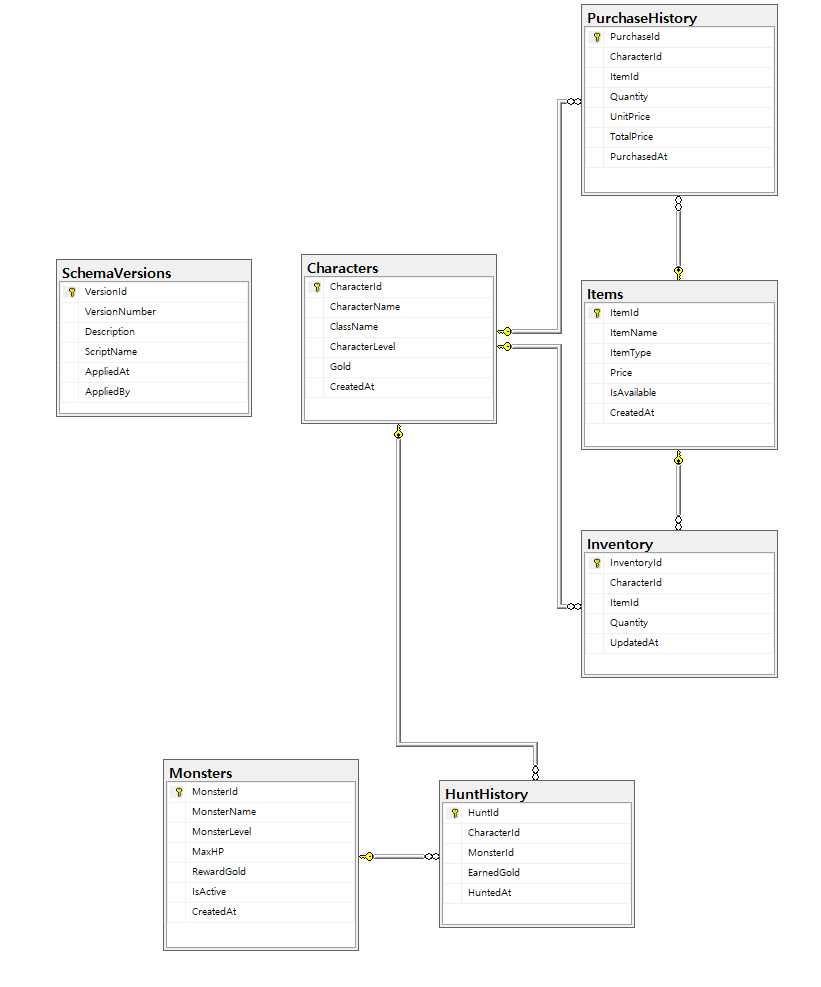

## 실습 환경 및 실행 순서

로컬 SQL Server에 접속하여 **새 데이터베이스**를 준비합니다.

```sql
CREATE DATABASE ForeverRPG;
GO
```

1. [초기 스키마 생성](database/migrations/V001__init_schema.sql) → [스키마 검증](database/tests/01_schema_validation.sql) 순서로 실행합니다.
2. [저장 프로시저 폴더](database/procedures/)의 조회 및 구매 프로시저를 생성합니다.
3. [구매 검증 SQL](database/tests/02_purchase_validation.sql)로 정상 구매·오류·롤백을 확인합니다.
4. 사냥 기록에 가상 데이터를 추가하고, 복합 인덱스 적용 전후 성능을 비교합니다. 측정 조건과 결과는 [인덱스 분석 보고서](docs/day03_index_optimization.md)에 정리했습니다.
5. [V002 패치 SQL](database/migrations/V002__add_character_last_login.sql)로 스키마 변경 상태를 검증하고, FULL 백업·별도 DB 복원 후 [복원 검증 SQL](database/tests/03_restore_validation.sql)을 실행합니다. 복원 검증에는 원본 DB와 복원 테스트 DB가 모두 필요합니다.
6. 개발 환경에서 [Blocking 재현 SQL](database/tests/04_blocking_test.sql)을 SSMS의 서로 다른 세션에 나누어 실행하고 [장애 대응 보고서](docs/day05_blocking_troubleshooting.md)의 순서대로 대기 및 해소를 확인합니다.
7. [Deadlock 재현 SQL](database/tests/05_deadlock_test.sql)을 세션별로 나누어 실행하고 [Deadlock XML 분석 보고서](docs/day05_deadlock_analysis.md)에서 교착 상태와 희생자 선택을 확인합니다.
8. [V003 패치](database/migrations/V003__add_battle_encounters.sql) 및 [전투 프로시저](database/procedures/)를 적용하고, FastAPI 서버와 웹 게임을 실행해 구매·전투를 검증합니다. 전투 검증 결과는 [9일 차 보고서](docs/day09_battle_validation.md)를 참고하세요.

> **주의:** 초기 스키마 파일은 새 DB에서 최초 1회만 실행합니다. 구매 검증 파일은 개발용 테스트 데이터가 준비된 상태에서 실행해야 합니다. 성능 비교에 사용된 강제 인덱스 힌트는 실험 목적이며 운영 쿼리에 권장하는 설정은 아닙니다.

## 실행 결과 이미지

### 초기 스키마 및 제약조건 검증

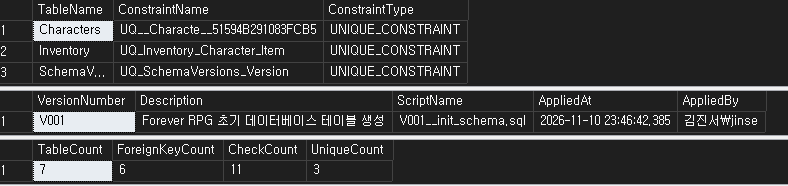


### 인덱스 성능 분석

최근 사냥 기록 20건 조회에서 강제 스캔과 복합 인덱스 사용 시 논리적 읽기가 각각 **449회, 3회**로 측정됐습니다.

**강제 스캔 결과 — 논리적 읽기 449**

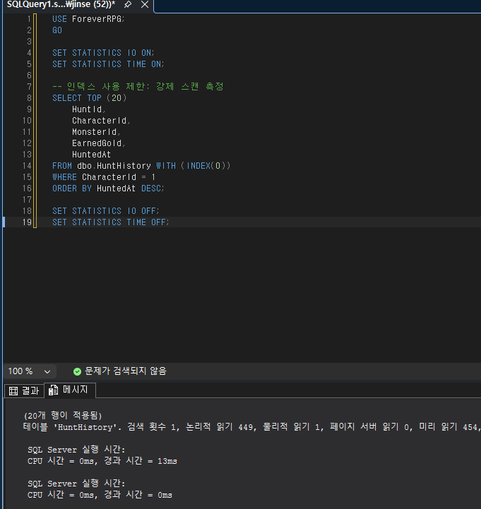

**복합 인덱스 결과 — 논리적 읽기 3**

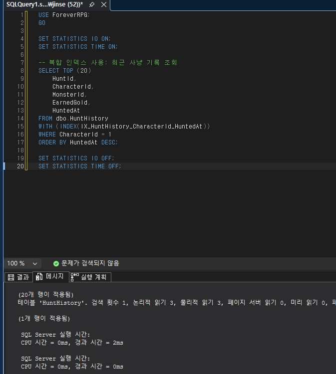

**인덱스 힌트 없는 실행 계획 — Index Seek**


측정 조건과 분석은 [3일 차 보고서](docs/day03_index_optimization.md)를 참고하세요.

### 데이터베이스 패치 및 복원 검증

**V002 패치 이력과 컬럼 구조**

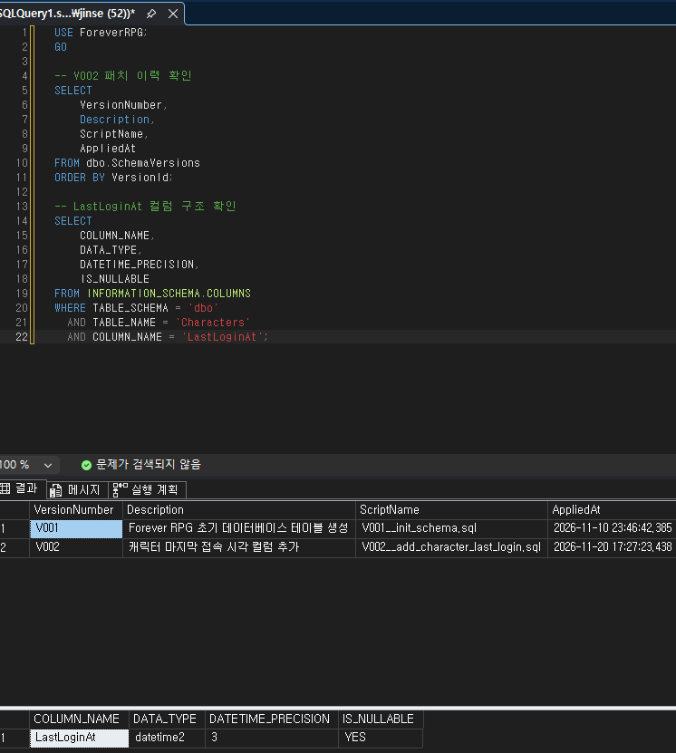

**전체 백업 성공**

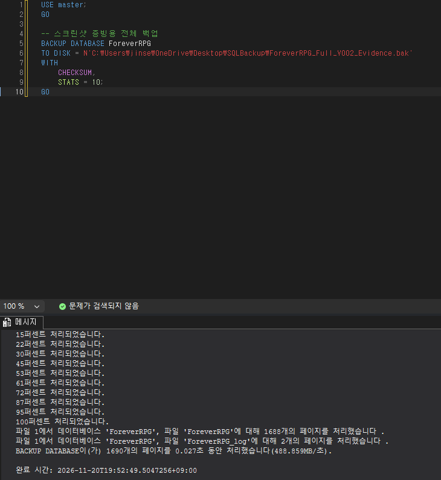

**별도 데이터베이스 복원 이력 및 상태**

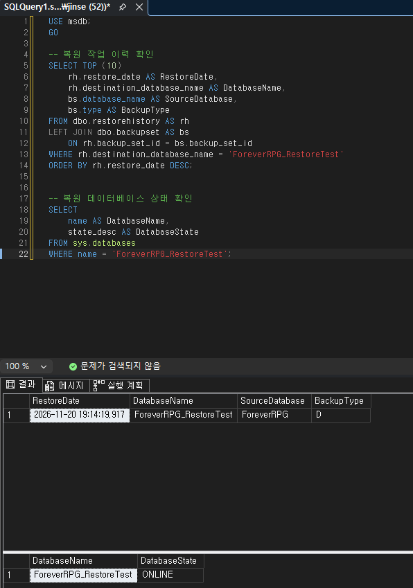

**원본·복원본의 데이터 건수 비교**


자세한 내용은 [4일 차 패치·백업·복원 보고서](docs/day04_patch_backup_restore.md)에 정리했습니다.

### Blocking 장애 대응

**잠금 대기 원인 분석 — 세션 92가 세션 78을 대기**


**트랜잭션 종료 상태 확인 — @@TRANCOUNT = 0**


**장애 해소 재검증 — 차단된 요청 0건**

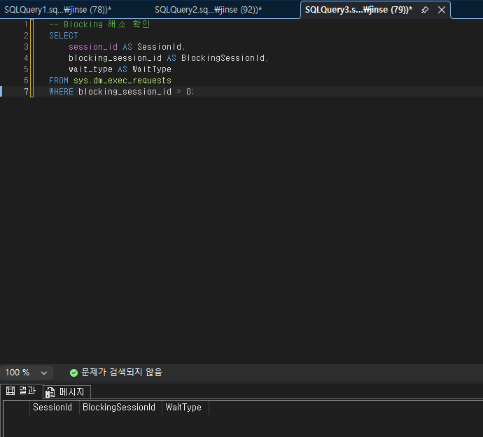

실습 절차와 결과는 [5일 차 Blocking 장애 대응 보고서](docs/day05_blocking_troubleshooting.md)에 정리했습니다.

### Deadlock 교착 상태 분석

**오류 1205 — 세션 B(SPID 75) 희생자 선정**

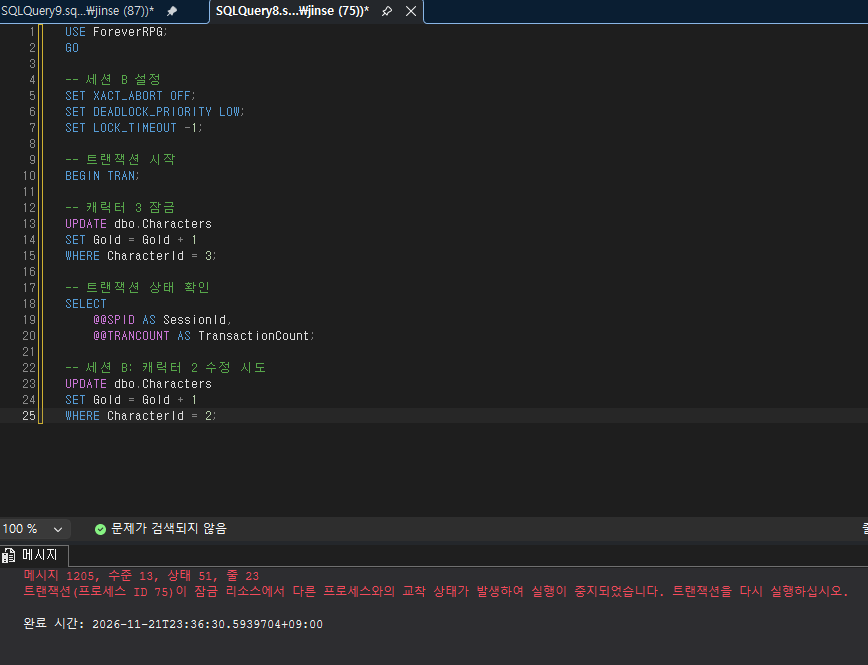

**트랜잭션 종료 확인**


**캐릭터 2·3 데이터 검증**


Deadlock Graph의 원본 XML에서 기본 키의 두 `KEY` 잠금에 대해 세션 87과 75가 서로 보유자·대기자로 나타나는 것을 확인했습니다. 개인 환경 식별 정보가 포함된 XML 원본 대신 [분석 보고서](docs/day05_deadlock_analysis.md)에 핵심 결과를 정리했습니다.

### 턴제 전투 및 중복 보상 검증

**전투 승리 — BattleId 1 / Won / RewardClaimed 1**

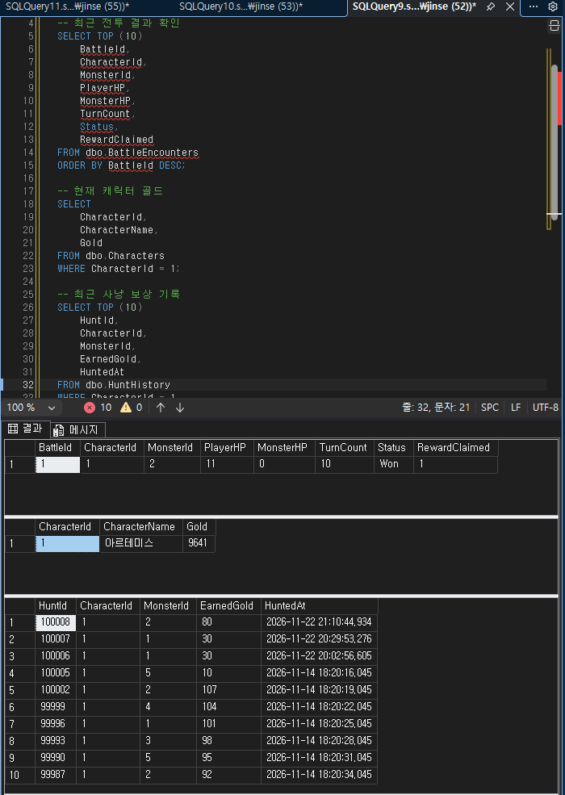

**종료된 전투에 대한 재공격 차단**

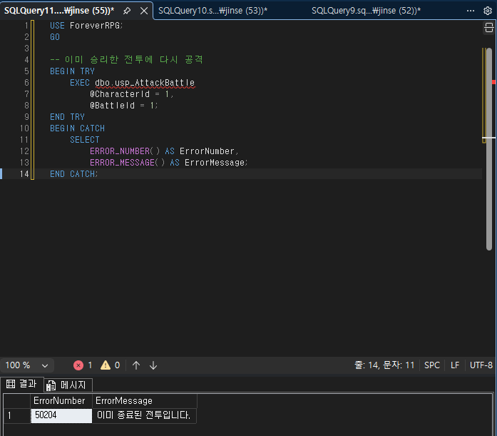

**재공격 이후 골드 및 사냥 기록 유지**

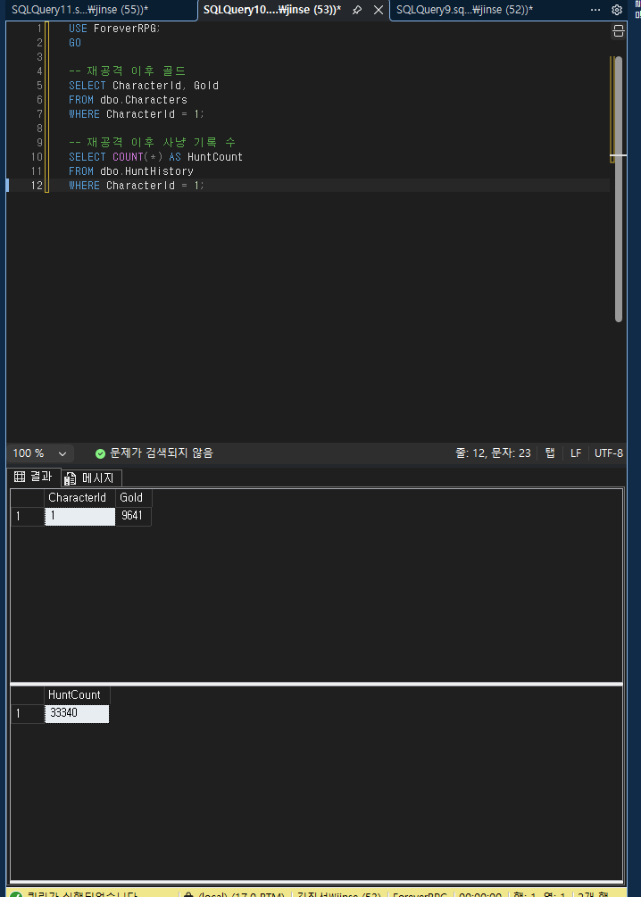

자세한 검증 조건과 결과는 [9일 차 전투 검증 보고서](docs/day09_battle_validation.md)에 정리했습니다. 순차 재공격은 검증했지만 동시 요청의 중복 지급 방지는 아직 부하 테스트로 검증하지 않았습니다.

## 진행 현황 및 다음 작업

| 단계 | 내용 | 상태 |
|---|---|---|
| 1일 차 | 데이터베이스 설계 및 제약조건 검증 | 완료 |
| 2일 차 | 저장 프로시저 및 트랜잭션 검증 | 완료 |
| 3일 차 | 가상 사냥 기록 생성 및 인덱스 성능 분석 | 완료 |
| 4일 차 | DB 패치 버전 관리, 백업 및 복원 | 완료 |
| 5일 차 | Blocking·Deadlock 장애 재현 및 분석 | 완료 |
| 6일 차 | FastAPI DB 연결 및 구매 API 실제 실행 | 완료 |
| 7일 차 | RPG 웹 게임 화면 코드 작성·GitHub 반영 | 화면 실행 확인 |
| 8일 차 | 모의 사냥 Stored Procedure 및 웹 게임 사냥터 연결 | 완료 |
| 9일 차 | V003 턴제 전투 및 순차 재공격 검증 | 완료 |
| 최종 정리 | 통합 보고서 및 기존 증빙 연결 | 완료 |
| 추가 검증 과제 | 동시 요청 부하·인증·재시도·복구 범위 확대 | 미수행 |

## 실습 범위와 한계

- 가상 데이터와 로컬 SQL Server를 사용한 개인 실습으로, 실제 라이브 게임 서버 성능을 대표하지 않습니다.
- 구매 실패 후 데이터 유지와 강제 오류에 따른 롤백, Blocking 감지 및 해소, Deadlock 재현 및 XML 분석을 검증했습니다. 다중 요청 부하와 애플리케이션 재시도 처리는 추가 검증이 필요합니다.
- 3일 차 인덱스 실험은 강제 스캔과 인덱스 사용의 비교이며, 인덱스 도입에 따른 쓰기 비용은 아직 측정하지 않았습니다.
- V002 패치와 전체 백업·복원 및 주요 객체 검증을 완료했습니다. 모든 행의 값 일치나 복구 시간 목표까지 검증한 것은 아닙니다.
- 게임 기능을 개별 검증한 결과는 확인했으나, 별도의 일괄 회귀 테스트·자동 테스트·동시 요청 부하 테스트까지 수행한 것은 아닙니다.

## AI 활용 및 직접 수행 범위

이 프로젝트에서는 **AI를 활용하여 개발 보조 코드와 SQL 초안을 작성**하고, 실제 데이터베이스 작업 및 검증은 로컬 환경에서 수행했습니다.

| 영역 | AI 활용 내용 | 직접 수행한 내용 |
|---|---|---|
| DB 설계·프로시저 | 테이블·제약조건 및 트랜잭션 SQL 초안 작성 지원 | SSMS 실행, 제약조건·구매 성공/실패·ROLLBACK 검증 |
| 인덱스·운영 | 성능 비교·패치·백업·복원 테스트 SQL 및 문서 정리 지원 | 인덱스 생성과 5회 측정, 실행 계획 분석, 패치·백업·복원 수행 |
| 장애 대응 | Blocking·Deadlock 재현 절차와 DMV/XML 해석 지원 | 세션별 오류 재현, 실제 대기 상태·Deadlock XML 수집 및 검증 |
| **게임 서버·API** | **AI를 활용한 FastAPI·pyodbc 연결, REST API 및 JavaScript `fetch()` 통신 코드 구현** | 로컬 서버 실행과 SQL Server 연결, 구매·사냥 API 실제 동작 확인 |
| **웹 게임·턴제 전투** | **AI를 활용한 HTML/CSS/JavaScript UI와 V003 전투 프로시저·전투 상태 로직 초안 구현** | 웹 게임에서 전투 수행, SSMS 승리·보상 상태 및 순차 재공격 후 데이터 유지 확인 |
| 문서화 | AI를 활용한 README와 일차별 보고서 문장 및 구성 정리 | 실습 결과·스크린샷 제공 및 실제 결과 확인 |

**구분 원칙:** AI가 코드 초안 또는 구현을 지원한 부분은 직접 작성한 코드로 표기하지 않았습니다. 반대로 SQL Server에서 실제 실행해 확인한 성능 수치와 검증 결과는 AI 생성 예시가 아닌 실습 측정 결과입니다. 각 일차별 보고서 하단에도 관련 내용을 별도로 기록했습니다.

**학습 내용:** 게임의 재화 변경을 안전하게 처리하는 방법과 조회 패턴에 맞춘 인덱스 설계·검증 과정을 익혔습니다.
