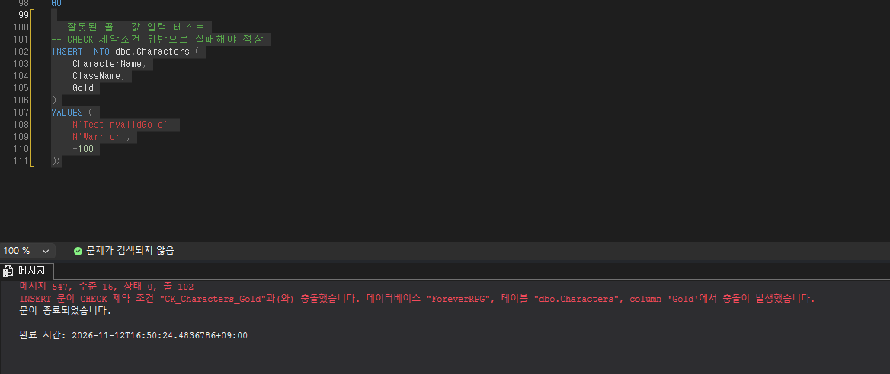
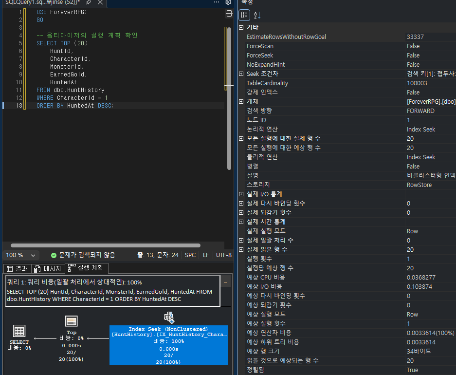
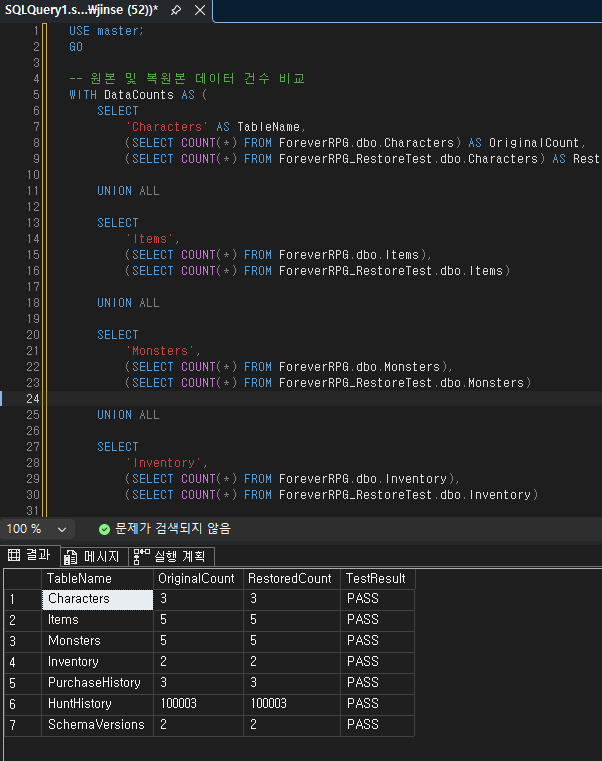
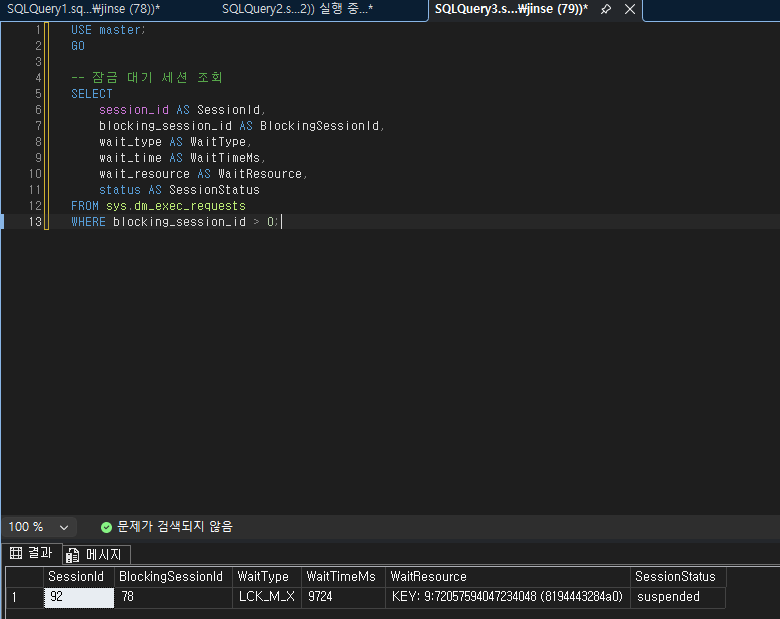
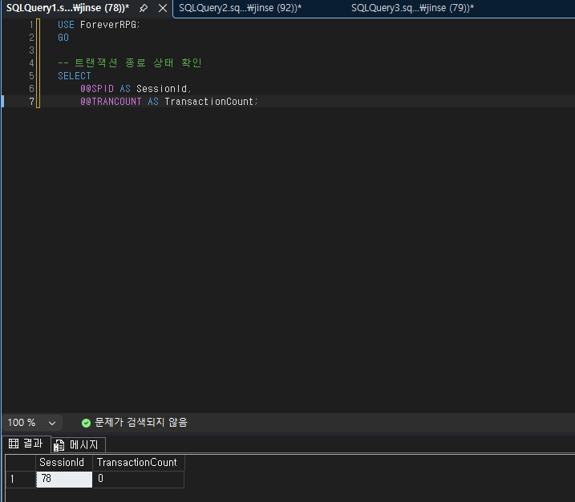
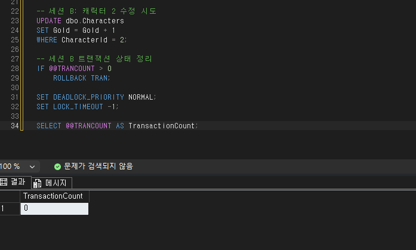
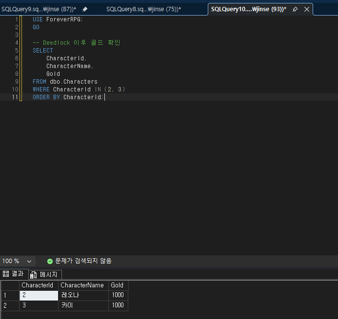

# Forever RPG — SQL Server DBA 실습

> **게임 데이터베이스 설계·구매 트랜잭션 검증·인덱스 성능 분석·운영 실습**

Microsoft SQL Server를 활용해 RPG 게임의 데이터 구조를 설계하고 구매 처리의 정합성과 사냥 기록 조회 성능을 검증하는 개인 DBA 실습 프로젝트입니다. 테스트에는 가상 게임 데이터를 사용했습니다.

## 주요 결과

| 항목 | 실습 결과 |
|---|---|
| 데이터베이스 설계 | 7개 테이블, 외래키 6개, CHECK 11개, UNIQUE 3개 |
| 구매 처리 | 저장 프로시저 3개 구현, 정상·실패 구매 검증 |
| 트랜잭션 | 골드 차감 후 강제 오류와 ROLLBACK 확인 |
| 인덱스 성능 | 최근 사냥 기록 20건 조회 시 논리적 읽기 449 → 3 (약 99.33% 감소) |
| 실행 계획 | 인덱스 힌트 없는 조회에서 Index Seek 확인 |
| DB 패치·복원 | V002 패치 재실행 검증, FULL 백업 및 별도 DB 복원 확인 |
| 장애 대응 | Blocking 재현 및 DMV 분석, 세션 92 → 78 대기(9,724ms), 해소 확인 |
| 교착 상태 분석 | 오류 1205 재현, Deadlock XML 분석, 희생자 SPID 75 및 키 잠금 순환 대기 확인 |

> 성능 수치는 로컬 실습에서 얻은 결과입니다. 449와 3은 각각 강제 스캔과 복합 인덱스를 사용한 5회 측정의 평균이며, 실제 서비스 환경의 개선율을 의미하지 않습니다.

## 상세 실습 보고서

| 보고서 | 주요 내용 |
|---|---|
| [01. 데이터베이스 설계 및 제약조건 검증](docs/day01_database_design.md) | 테이블 관계, 제약조건, 초기 스키마 |
| [02. 저장 프로시저 및 트랜잭션 검증](docs/day02_transaction_test.md) | 구매 처리, 오류 발생, ROLLBACK |
| [03. 인덱스 및 쿼리 성능 분석](docs/day03_index_optimization.md) | 사냥 기록 약 10만 건, 실행 계획, 5회 측정 |
| [04. DB 패치 및 백업·복원 검증](docs/day04_patch_backup_restore.md) | V002 패치, 복원 이력, 원본·복원본 검증 |
| [05. Blocking 장애 재현 및 대응](docs/day05_blocking_troubleshooting.md) | 세션 간 잠금 대기, DMV 원인 분석, ROLLBACK 및 해소 검증 |
| [05. Deadlock 재현 및 XML 분석](docs/day05_deadlock_analysis.md) | 오류 1205, 희생자 선정, PK 키 잠금 순환 대기 검증 |

## 사용 기술

**Microsoft SQL Server · SSMS · T-SQL · Git · GitHub**

게임 서버 연동 진행 중: Python(FastAPI), pyodbc (캐릭터 조회·인벤토리 조회·구매 API 구현, 웹 클라이언트 예정)

실습 상세 내용과 SQL 실행 근거는 각 일차별 보고서 및 테스트 파일에서 확인할 수 있습니다.

성능 확인: `SET STATISTICS IO`, `SET STATISTICS TIME`, 실제 실행 계획  
동시성 제어: `UPDLOCK`, `HOLDLOCK`, `TRY/CATCH`, `XACT_STATE()`

## FastAPI 게임 서버 실행 (개발 환경)

\`backend/\`에 SQL Server 연결 및 조회 API의 초기 코드를 추가했습니다. Windows에서 Python과 Microsoft ODBC Driver 18 for SQL Server를 설치하고 아래 명령을 실행합니다.

```powershell
cd backend
py -m venv .venv
.venv\\Scripts\\Activate.ps1
python -m pip install -r requirements.txt
Copy-Item .env.example .env
uvicorn main:app --reload
```

\`.env\`의 \`DB_SERVER\`를 SSMS에서 접속하는 SQL Server 이름에 맞게 수정하고, 사용 가능한 ODBC 드라이버도 확인합니다. Windows 인증을 사용하는 경우 FastAPI 실행 계정에 DB 연결 권한이 필요합니다. \`.env\`는 Git에 업로드하지 않습니다.

첫 연결 테스트: \`http://127.0.0.1:8000/health\`, 캐릭터 조회: \`http://127.0.0.1:8000/characters/1\`, API 문서: \`http://127.0.0.1:8000/docs\`. 구매 API 및 웹 화면은 후속 단계에서 구현할 예정입니다.

## 프로젝트 구성

```text
forever-rpg-mssql-dba/
├── backend/                    # FastAPI 및 SQL Server 연결
├── database/
│   ├── migrations/             # 최초 데이터베이스 스키마
│   ├── procedures/             # 캐릭터·아이템 조회 및 구매 처리
│   └── tests/                  # 스키마·구매 검증 SQL
├── docs/                       # 일자별 실습 보고서
├── screenshots/                # 실행 결과 이미지
└── README.md
```

## 데이터베이스 구조

캐릭터, 아이템, 몬스터를 중심으로 인벤토리와 구매·사냥 이력을 연결했습니다. 별도의 `SchemaVersions` 테이블에서 스키마 변경 버전을 관리할 수 있도록 준비했습니다.


## 실습 환경 및 실행 순서

로컬 SQL Server에 접속하여 **새 데이터베이스**를 준비합니다.

```sql
CREATE DATABASE ForeverRPG;
GO
```

1. [초기 스키마 생성](database/migrations/V001__init_schema.sql) → [스키마 검증](database/tests/01_schema_validation.sql) 순서로 실행합니다.
2. [저장 프로시저 폴더](database/procedures/)의 조회 및 구매 프로시저를 생성합니다.
3. [구매 검증 SQL](database/tests/02_purchase_validation.sql)로 정상 구매·오류·롤백을 확인합니다.
4. 사냥 기록에 가상 데이터를 추가하고, 복합 인덱스 적용 전후 성능을 비교합니다. 측정 조건과 결과는 [인덱스 분석 보고서](docs/day03_index_optimization.md)에 정리했습니다.
5. [V002 패치 SQL](database/migrations/V002__add_character_last_login.sql)로 스키마 변경 상태를 검증하고, FULL 백업·별도 DB 복원 후 [복원 검증 SQL](database/tests/03_restore_validation.sql)을 실행합니다. 복원 검증에는 원본 DB와 복원 테스트 DB가 모두 필요합니다.
6. 개발 환경에서 [Blocking 재현 SQL](database/tests/04_blocking_test.sql)을 SSMS의 서로 다른 세션에 나누어 실행하고 [장애 대응 보고서](docs/day05_blocking_troubleshooting.md)의 순서대로 대기 및 해소를 확인합니다.
7. [Deadlock 재현 SQL](database/tests/05_deadlock_test.sql)을 세션별로 나누어 실행하고 [Deadlock XML 분석 보고서](docs/day05_deadlock_analysis.md)에서 교착 상태와 희생자 선택을 확인합니다.

> **주의:** 초기 스키마 파일은 새 DB에서 최초 1회만 실행합니다. 구매 검증 파일은 개발용 테스트 데이터가 준비된 상태에서 실행해야 합니다. 성능 비교에 사용된 강제 인덱스 힌트는 실험 목적이며 운영 쿼리에 권장하는 설정은 아닙니다.

## 실행 결과 이미지

### 초기 스키마 및 제약조건 검증




### 인덱스 성능 분석

최근 사냥 기록 20건 조회에서 강제 스캔과 복합 인덱스 사용 시 논리적 읽기가 각각 **449회, 3회**로 측정됐습니다.

**강제 스캔 결과 — 논리적 읽기 449**


**복합 인덱스 결과 — 논리적 읽기 3**


**인덱스 힌트 없는 실행 계획 — Index Seek**



측정 조건과 분석은 [3일 차 보고서](docs/day03_index_optimization.md)를 참고하세요.

### 데이터베이스 패치 및 복원 검증

**V002 패치 이력과 컬럼 구조**


**전체 백업 성공**


**별도 데이터베이스 복원 이력 및 상태**


**원본·복원본의 데이터 건수 비교**



자세한 내용은 [4일 차 패치·백업·복원 보고서](docs/day04_patch_backup_restore.md)에 정리했습니다.

### Blocking 장애 대응

**잠금 대기 원인 분석 — 세션 92가 세션 78을 대기**



**트랜잭션 종료 상태 확인 — @@TRANCOUNT = 0**



**장애 해소 재검증 — 차단된 요청 0건**


실습 절차와 결과는 [5일 차 Blocking 장애 대응 보고서](docs/day05_blocking_troubleshooting.md)에 정리했습니다.

### Deadlock 교착 상태 분석

**오류 1205 — 세션 B(SPID 75) 희생자 선정**


**트랜잭션 종료 확인**



**캐릭터 2·3 데이터 검증**



Deadlock Graph의 원본 XML에서 기본 키의 두 `KEY` 잠금에 대해 세션 87과 75가 서로 보유자·대기자로 나타나는 것을 확인했습니다. 개인 환경 식별 정보가 포함된 XML 원본 대신 [분석 보고서](docs/day05_deadlock_analysis.md)에 핵심 결과를 정리했습니다.

## 진행 현황 및 다음 작업

| 단계 | 내용 | 상태 |
|---|---|---|
| 1일 차 | 데이터베이스 설계 및 제약조건 검증 | 완료 |
| 2일 차 | 저장 프로시저 및 트랜잭션 검증 | 완료 |
| 3일 차 | 가상 사냥 기록 생성 및 인덱스 성능 분석 | 완료 |
| 4일 차 | DB 패치 버전 관리, 백업 및 복원 | 완료 |
| 5일 차 | Blocking·Deadlock 장애 재현 및 분석 | 완료 |
| 다음 단계 | FastAPI 백엔드 및 RPG 게임 연동 | 예정 |

## 실습 범위와 한계

- 가상 데이터와 로컬 SQL Server를 사용한 개인 실습으로, 실제 라이브 게임 서버 성능을 대표하지 않습니다.
- 구매 실패 후 데이터 유지와 강제 오류에 따른 롤백, Blocking 감지 및 해소, Deadlock 재현 및 XML 분석을 검증했습니다. 다중 요청 부하와 애플리케이션 재시도 처리는 추가 검증이 필요합니다.
- 3일 차 인덱스 실험은 강제 스캔과 인덱스 사용의 비교이며, 인덱스 도입에 따른 쓰기 비용은 아직 측정하지 않았습니다.
- V002 패치와 전체 백업·복원 및 주요 객체 검증을 완료했습니다. 모든 행의 값 일치나 복구 시간 목표까지 검증한 것은 아닙니다.

## AI 활용 범위

AI는 초기 스키마 및 저장 프로시저 초안, SQL 실습 안내와 문서 정리를 지원했습니다. SQL Server에서 스크립트 실행, 구매 검증, 실행 계획 확인, 성능 측정, 패치 및 백업·복원 검증, Blocking·Deadlock 실습은 직접 수행했습니다.

**학습 내용:** 게임의 재화 변경을 안전하게 처리하는 방법과 조회 패턴에 맞춘 인덱스 설계·검증 과정을 익혔습니다.
