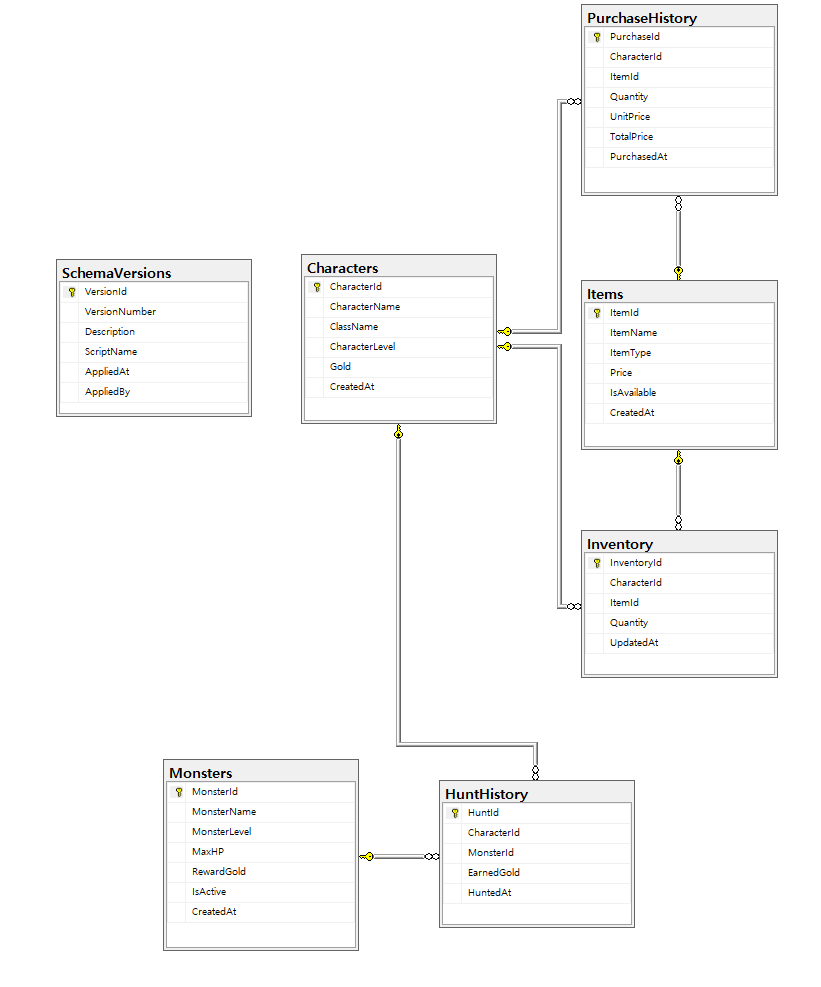
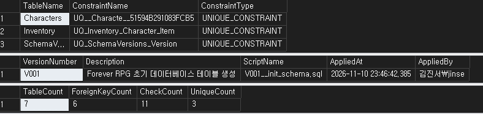
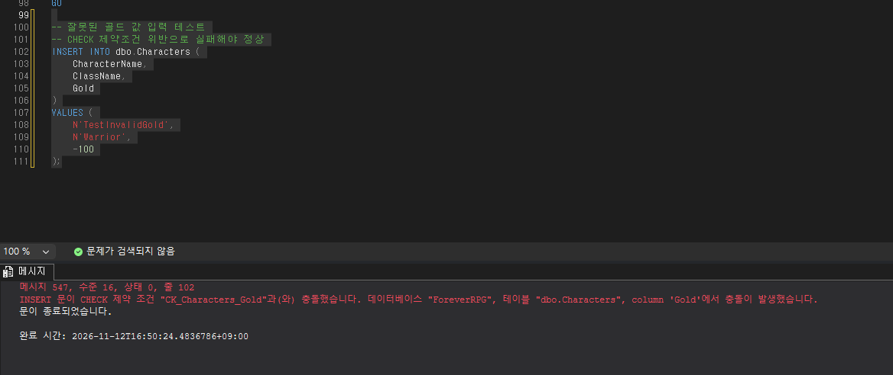

# Day 1 — Database Schema Design

## 1. 작업 개요

Forever RPG는 RPG 게임에서 발생하는 캐릭터, 아이템, 몬스터 및 게임 활동 데이터를 관리하는 Microsoft SQL Server 기반 프로젝트입니다.

Day 1에서는 관계형 데이터베이스의 구조를 설계하고, PK, FK, UNIQUE, CHECK 등의 제약조건을 활용하여 데이터 정합성과 참조 무결성을 확보하는 데 집중했습니다.

### 작업 목표

- RPG 게임의 주요 엔터티를 관계형 테이블로 구성
- 기본키와 외래키를 통한 테이블 관계 설정
- CHECK 및 UNIQUE 제약조건을 활용한 데이터 무결성 관리
- 구매 및 사냥 이력 데이터의 독립적인 보존
- SQL Server 시스템 카탈로그를 활용한 스키마 검증

## 2. 데이터베이스 구조

### 2.1 ERD

SQL Server에서 생성한 7개 테이블과 6개 외래키 관계를 시각화했습니다.



### 2.2 주요 테이블

| 테이블 | 역할 | 주요 설계 요소 |
|---|---|---|
| Characters | 캐릭터 정보 및 보유 골드 관리 | PK, UNIQUE, CHECK |
| Items | 아이템 정보 및 판매 가격 관리 | PK, CHECK |
| Monsters | 몬스터 정보 및 사냥 보상 관리 | PK, CHECK |
| Inventory | 캐릭터별 아이템 보유 현황 | PK, FK, UNIQUE, CHECK |
| PurchaseHistory | 아이템 구매 이력 관리 | PK, FK, CHECK |
| HuntHistory | 몬스터 사냥 이력 관리 | PK, FK, CHECK |
| SchemaVersions | DB 스키마 변경 버전 관리 | PK, UNIQUE |

### 2.3 테이블 관계

| 부모 테이블 | 자식 테이블 | 관계 |
|---|---|---|
| Characters | Inventory | 1:N |
| Items | Inventory | 1:N |
| Characters | PurchaseHistory | 1:N |
| Items | PurchaseHistory | 1:N |
| Characters | HuntHistory | 1:N |
| Monsters | HuntHistory | 1:N |

SchemaVersions는 게임 데이터와 별도로 관리하는 테이블이므로 다른 테이블과 외래키 관계를 설정하지 않았습니다.

## 3. 주요 설계 내용

### 3.1 Inventory — 중복 데이터 방지

캐릭터는 여러 종류의 아이템을 보유할 수 있으며, 동일 아이템을 여러 개 보유할 수도 있습니다.

동일 캐릭터와 아이템의 조합이 여러 행에 중복 저장되는 것을 방지하기 위해 복합 UNIQUE 제약조건을 적용했습니다.

```sql
CONSTRAINT UQ_Inventory_Character_Item
    UNIQUE (CharacterId, ItemId)
```

예를 들어 캐릭터 1번이 철검 2개를 보유한다면 `(CharacterId=1, ItemId=1, Quantity=2)`로 관리합니다.

같은 캐릭터가 철검을 추가로 획득할 경우 별도의 행을 추가하는 대신 기존 Quantity를 변경하도록 구현할 예정입니다.

### 3.2 PurchaseHistory — 구매 당시 가격 보존

게임 운영 중 아이템 가격이 변경되더라도 과거 구매 기록은 영향을 받지 않아야 합니다.

따라서 PurchaseHistory에는 현재 아이템 가격과 별도로 구매 당시의 UnitPrice를 저장하도록 설계했습니다.

또한 구매 수량과 단가를 기준으로 총 구매 금액이 일치하는지 검증합니다.

```sql
CONSTRAINT CK_PurchaseHistory_TotalPrice
    CHECK (
        TotalPrice = CAST(UnitPrice AS BIGINT) * Quantity
    )
```

단가를 BIGINT로 형변환하여 곱셈 과정에서 발생할 수 있는 INT 범위 초과 문제를 방지했습니다.

### 3.3 HuntHistory — 사냥 보상 이력 보존

몬스터 보상은 게임 업데이트나 밸런스 조정에 따라 변경될 수 있습니다.

예를 들어 슬라임의 기본 보상이 30골드에서 50골드로 변경되더라도, 과거 사냥 기록에는 실제 지급된 30골드가 남아 있어야 합니다.

이를 위해 HuntHistory에 EarnedGold 컬럼을 별도로 구성했습니다.

이후 Stored Procedure를 통해 골드 지급과 사냥 이력 기록을 하나의 트랜잭션으로 처리할 예정입니다.

### 3.4 데이터 무결성 관리

게임 데이터의 유효성을 검증하기 위해 총 11개의 CHECK 제약조건을 설정했습니다.

| 테이블 | 검증 대상 | 조건 |
|---|---|---|
| Characters | CharacterLevel | 1 이상 |
| Characters | Gold | 0 이상 |
| Items | Price | 0 이상 |
| Monsters | MonsterLevel | 1 이상 |
| Monsters | MaxHP | 1 이상 |
| Monsters | RewardGold | 0 이상 |
| Inventory | Quantity | 1 이상 |
| PurchaseHistory | Quantity | 1 이상 |
| PurchaseHistory | UnitPrice | 0 이상 |
| PurchaseHistory | TotalPrice | UnitPrice × Quantity |
| HuntHistory | EarnedGold | 0 이상 |

CHECK 제약조건은 데이터의 유효 범위를 제한하며, NOT NULL 및 외래키와 함께 사용하여 잘못된 데이터가 저장되는 상황을 줄일 수 있도록 구성했습니다.

### 3.5 SchemaVersions — DB 변경 이력 관리

게임 서비스에서는 테이블과 Stored Procedure가 지속적으로 변경될 수 있으므로, 적용된 DB 버전을 추적하기 위한 SchemaVersions 테이블을 구성했습니다.

초기 버전은 V001로 정의했습니다.

```text
VersionNumber : V001
ScriptName    : V001__init_schema.sql
Description   : Forever RPG 초기 데이터베이스 테이블 생성
```

이후 DB 변경 작업은 버전별 SQL 파일로 관리하고, 적용 결과를 검증한 후 이력을 기록할 예정입니다.

단, 버전 기록 자체가 실제 DB 패치의 성공을 보장하는 것은 아니므로 패치 적용 및 검증 절차는 별도로 관리해야 합니다.

## 4. 스키마 검증

### 4.1 검증 방법

SQL Server의 시스템 카탈로그를 활용하여 실제 생성된 테이블과 제약조건 구성을 확인했습니다.

- `sys.tables` — 사용자 테이블 확인
- `sys.foreign_keys` — 외래키 관계 확인
- `sys.check_constraints` — CHECK 제약조건 확인
- `sys.key_constraints` — UNIQUE 제약조건 확인
- `dbo.SchemaVersions` — 스키마 버전 조회

검증 SQL: [01_schema_validation.sql](../database/tests/01_schema_validation.sql)

### 4.2 스키마 검증 결과

| 검증 항목 | 결과 |
|---|---:|
| Tables | 7 |
| Foreign Keys | 6 |
| CHECK Constraints | 11 |
| UNIQUE Constraints | 3 |

아래 이미지는 SSMS에서 직접 실행한 스키마 검증 결과입니다.



### 4.3 제약조건 검증

유효하지 않은 데이터 입력을 통해 CHECK 제약조건이 정상적으로 작동하는지 확인했습니다.

예를 들어 캐릭터의 보유 골드를 음수로 입력하면 `CK_Characters_Gold` 제약조건에 의해 INSERT가 거부됩니다.

```sql
INSERT INTO dbo.Characters (
    CharacterName,
    ClassName,
    Gold
)
VALUES (
    N'TestInvalidGold',
    N'Warrior',
    -100
);
```

해당 테스트는 실패하는 것이 정상이며, 잘못된 데이터가 저장되지 않음을 확인하기 위한 검증입니다.



### 4.4 검증 범위 및 한계

Day 1에서는 테이블 생성, 외래키 관계, 제약조건 구성 및 일부 비정상 데이터 입력 테스트를 진행했습니다.

다만 스키마 검증만으로 실제 게임 재화 처리의 정합성이 보장되는 것은 아닙니다.

골드 차감과 아이템 지급 사이에 오류가 발생하는 상황, 동시 구매 요청, 트랜잭션 실패 및 ROLLBACK 동작은 후속 단계에서 검증할 계획입니다.

## 5. 개선 및 후속 계획

### Day 2 — Stored Procedure & Transaction

- 아이템 구매 Stored Procedure 구현
- 골드 부족 및 잘못된 구매 요청 처리
- 골드 차감, 인벤토리 변경, 구매 이력 저장의 원자성 보장
- TRY/CATCH 및 ROLLBACK 동작 검증

### Day 3 — Query Performance Optimization

- 대량 구매·사냥 기록 생성
- 인덱스 적용 전후 실행 계획 비교
- STATISTICS IO를 활용한 논리적 읽기 비교
- 인덱스 추가에 따른 쓰기 비용 검토

### Day 4 — Database Patching & Recovery

- Stored Procedure 변경 버전 관리
- DB 패치 검수
- 전체 백업 및 복원 실습

## 6. Day 1 작업 결과

총 7개 테이블과 6개 외래키 관계를 구성하고, 11개 CHECK 제약조건 및 3개 UNIQUE 제약조건을 적용했습니다.

SQL Server 시스템 카탈로그 조회를 통해 스키마 구조를 검증하고, 제약조건 위반 테스트를 통해 잘못된 데이터 입력을 차단하는 동작을 확인했습니다.

이를 바탕으로 다음 단계에서는 실제 게임 로직과 트랜잭션을 구현하여 데이터 변경 작업의 정합성을 검증할 예정입니다.
