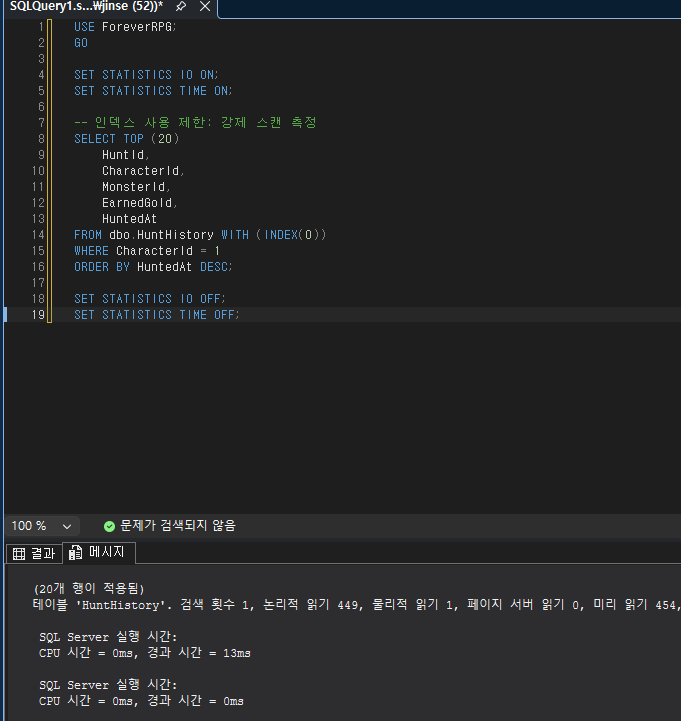
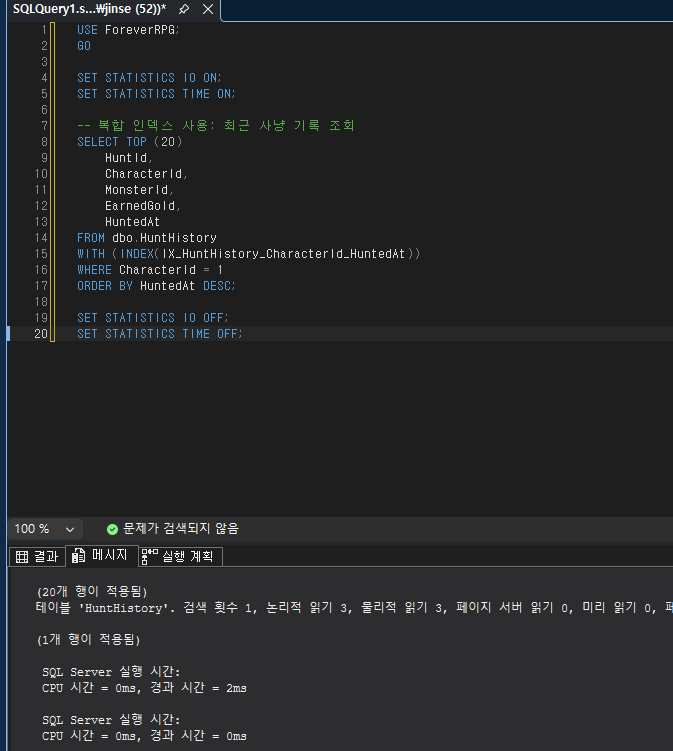
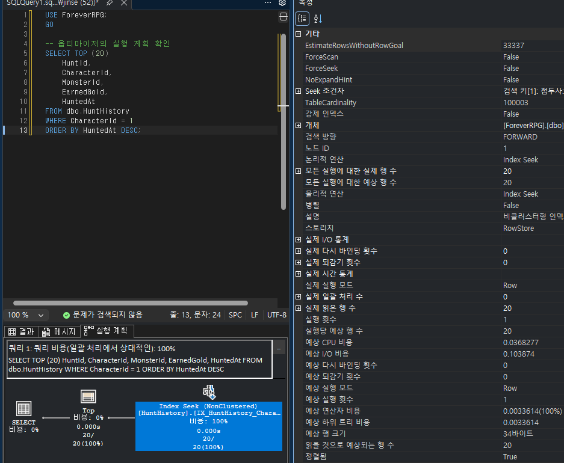

# 3일 차 — 인덱스 설계 및 쿼리 성능 분석

## 1. 작업 목적

Forever RPG의 사냥 기록 데이터가 증가하는 상황을 가정하여, 캐릭터별 최근 사냥 기록 조회 성능을 개선하는 실습을 진행했습니다.

SQL Server의 실제 실행 계획과 `SET STATISTICS IO`, `SET STATISTICS TIME`을 활용하여 인덱스 적용 전후의 데이터 접근 방식과 성능을 비교했습니다.

## 2. 테스트 환경

- DBMS: Microsoft SQL Server
- 데이터베이스: ForeverRPG
- 대상 테이블: `dbo.HuntHistory`
- 데이터 규모: 약 100,003건
- 조회 조건: `CharacterId = 1`
- 정렬 조건: `HuntedAt DESC`
- 테스트 쿼리: 최근 사냥 기록 TOP 20 조회

## 3. 인덱스 설계

캐릭터별 최신 사냥 기록 조회에 적합하도록 복합 비클러스터형 인덱스를 생성했습니다.

```sql
CREATE NONCLUSTERED INDEX IX_HuntHistory_CharacterId_HuntedAt
ON dbo.HuntHistory (
    CharacterId,
    HuntedAt DESC
)
INCLUDE (
    MonsterId,
    EarnedGold
);
```

`CharacterId`를 첫 번째 키로 배치하여 캐릭터별 검색을 지원하고, `HuntedAt DESC`를 두 번째 키로 설정하여 최신순 조회에 활용하도록 설계했습니다.

`MonsterId`와 `EarnedGold`는 INCLUDE 컬럼으로 지정하여 추가 데이터 조회 비용을 줄이고자 했습니다.

## 4. 성능 비교

최근 사냥 기록 20건 조회를 기준으로 `INDEX(0)`을 통한 스캔과 복합 인덱스 사용을 각각 5회 비교했습니다.

| 측정 항목 | 스캔 | 복합 인덱스 |
|---|---:|---:|
| 1회 논리적 읽기 | 449 | 3 |
| 2회 논리적 읽기 | 449 | 3 |
| 3회 논리적 읽기 | 449 | 3 |
| 4회 논리적 읽기 | 449 | 3 |
| 5회 논리적 읽기 | 449 | 3 |
| 평균 논리적 읽기 | 449.0 | 3.0 |
| 대표 실행 시간 | 8ms | 1ms |

**논리적 읽기 감소율: 약 99.33%**

복합 인덱스를 사용했을 때 데이터 페이지 읽기 횟수가 크게 줄어든 것을 확인했습니다.

`INDEX(0)`은 인덱스 사용을 제한한 비교 실험이므로, 인덱스 생성 전 원래 실행 계획과 동일하다고 단정할 수는 없습니다.

### 4.1 강제 스캔 측정 결과

`WITH (INDEX(0))`을 사용한 조회에서 논리적 읽기 **449회**를 확인했습니다.



### 4.2 복합 인덱스 측정 결과

복합 인덱스를 지정한 조회에서 논리적 읽기 **3회**를 확인했습니다.



실행 시간 역시 대표 측정값 기준으로 감소했으나, 측정 환경에 따른 변동 가능성이 있어 반복 측정된 Logical Reads를 주요 비교 지표로 활용했습니다.

## 5. 실행 계획 분석

인덱스 힌트를 제거한 쿼리에서도 옵티마이저가 `Index Seek`를 선택하는 것을 확인했습니다.

실제 실행 계획에서 확인한 주요 결과는 다음과 같습니다.

| 항목 | 결과 |
|---|---|
| Physical Operation | Index Seek |
| Actual Number of Rows | 20 |
| Actual Number of Rows Read | 20 |
| Estimated Number of Rows | 20 |
| Ordered | True |

힌트 없는 조회에서 Index Seek 연산자가 20행을 읽고 20행을 반환하는 것을 확인했습니다. 해당 연산자가 정렬된 순서로 행을 반환하는 것도 확인했습니다.



## 6. 분석 결과

이번 실습을 통해 쿼리의 검색 조건과 정렬 조건에 맞는 복합 인덱스 설계가 데이터 접근 효율을 개선할 수 있음을 확인했습니다.

특히 데이터 건수가 증가하는 환경에서는 인덱스의 키 순서 및 INCLUDE 컬럼 구성이 조회 성능에 영향을 미칠 수 있습니다.

다만 인덱스를 추가하면 저장 공간이 사용되고 데이터 변경 시 인덱스 유지 비용이 발생하므로, 조회 성능 개선뿐 아니라 운영 비용도 함께 고려해야 합니다.

## 7. 다음 단계

4일 차에서는 SQL Server의 데이터베이스 패치 버전 관리, 백업 및 복구를 실습할 예정입니다.

## AI 활용 및 직접 수행 범위

- **AI를 활용한 작업:** 인덱스 실습용 쿼리와 성능 비교 절차의 초안, 결과 보고서 정리 지원
- **직접 수행한 작업:** SQL Server에서 사냥 기록 데이터 준비, 인덱스 생성, `SET STATISTICS IO` 측정 5회 반복, 실제 실행 계획 및 `Index Seek` 확인

논리적 읽기 449회와 3회는 AI가 추정한 값이 아니라 실제 SSMS 실행 결과입니다.
