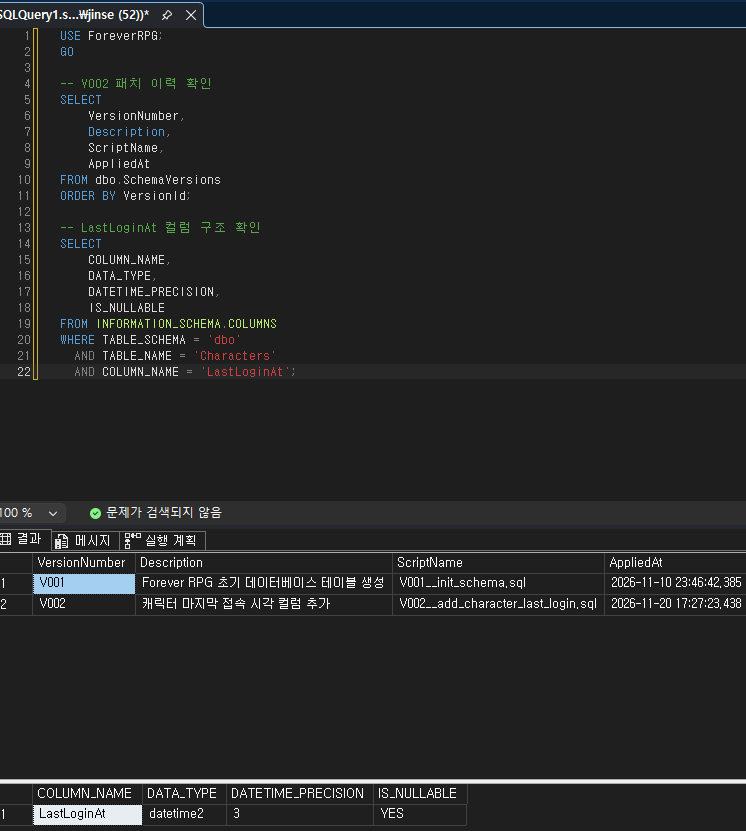
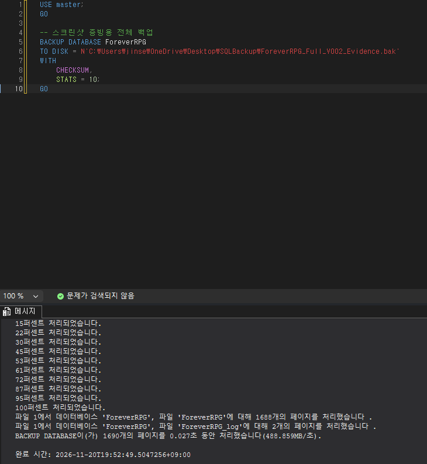
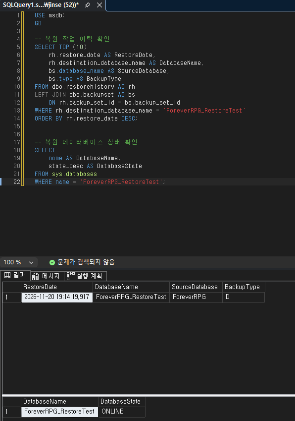
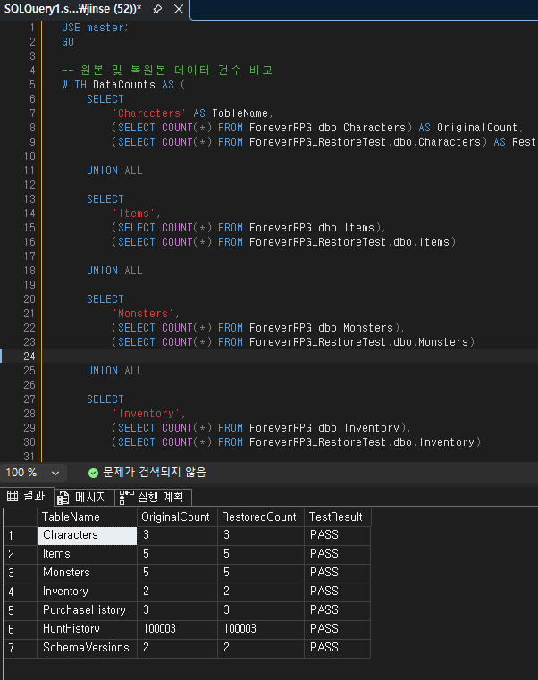

# 4일 차 — 데이터베이스 패치 및 백업·복원 검증

## 1. 작업 목적

Forever RPG의 데이터베이스 변경 사항을 버전별로 관리하고, 전체 백업 파일로 별도 데이터베이스를 복원하여 주요 데이터와 객체가 유지되는지 확인했습니다.

실습 환경은 Microsoft SQL Server와 SSMS이며, 가상 게임 데이터를 사용했습니다.

## 2. V002 스키마 패치

초기 버전 V001에 이어 캐릭터의 마지막 접속 시각을 저장하기 위한 `LastLoginAt DATETIME2(3) NULL` 컬럼을 추가했습니다.

첫 실행 때 `ALTER TABLE`을 별도로 수행해 컬럼은 생성됐으나 `SchemaVersions`에는 V001만 기록된 상태를 확인했습니다. 이후 [V002 패치 SQL](../database/migrations/V002__add_character_last_login.sql)을 통해 기존 컬럼의 구조를 확인하고 V002 이력을 등록했습니다.

패치 스크립트는 컬럼이 없으면 생성하고, 있으면 타입·정밀도·NULL 허용 여부를 검증합니다. 이미 기록된 V002 버전은 중복 등록하지 않도록 구성했습니다. 동일 스크립트를 재실행해 V002 등록 건수가 1건으로 유지됨을 확인했습니다.

### 패치 적용 결과

- 적용 이력: V001, V002
- 신규 컬럼: `Characters.LastLoginAt`
- 컬럼 속성: `datetime2(3) NULL`
- 기존 캐릭터 데이터: 유지



## 3. FULL 백업

`BACKUP DATABASE`를 이용해 `ForeverRPG` 전체 백업을 생성했습니다.

```sql
BACKUP DATABASE ForeverRPG
TO DISK = N'<SQL Server 서비스 계정이 접근 가능한 경로>\ForeverRPG_Full_V002.bak'
WITH CHECKSUM, STATS = 10;
```

백업 파일 경로는 SQL Server 서비스가 접근 가능한 디렉터리로 지정해야 합니다. 실제 실습에서는 기본 백업 경로에서 운영 체제 오류 5(액세스 거부)가 발생했고, 접근 가능한 별도 경로를 이용하여 백업에 성공했습니다. 이후 `RESTORE VERIFYONLY ... WITH CHECKSUM` 검사도 완료했습니다.

> `RESTORE VERIFYONLY`는 백업 파일을 검증하는 단계이며, 실제 복원 성공을 대신하지 않습니다. `.bak` 파일은 GitHub에 업로드하지 않았습니다.



## 4. 별도 데이터베이스 복원

전체 백업 파일을 `ForeverRPG_RestoreTest`라는 별도 DB로 복원했습니다. `RESTORE FILELISTONLY`로 논리적 파일명을 확인하고, `RESTORE DATABASE ... WITH MOVE`를 통해 원본과 다른 물리적 데이터·로그 파일명으로 복원했습니다.

복원 이력(`msdb.dbo.restorehistory`)에서 복원 대상과 원본 백업 정보를 확인했으며, 복원본의 상태가 `ONLINE`인 것도 확인했습니다.



## 5. 복원 결과 검증

원본 `ForeverRPG`와 복원본 `ForeverRPG_RestoreTest`의 7개 테이블 행 수를 비교했습니다. 실습 당시 비교 결과는 모두 일치했습니다.

추가로 복원본에 V001·V002 이력, `LastLoginAt` 컬럼 및 저장 프로시저 `usp_GetCharacter`, `usp_GetItem`, `usp_PurchaseItem`이 존재하는지 확인했습니다.

검증 SQL: [03_restore_validation.sql](../database/tests/03_restore_validation.sql)



**검증 범위:** 테이블별 행 수와 주요 DB 객체의 존재 여부를 확인했습니다. 행 수가 같더라도 모든 행의 값이 완전히 동일하다는 보장은 없으며, 백업 시점 이후 원본이 변경되면 두 데이터베이스 간 차이가 발생할 수 있습니다.

## 6. 발생한 문제와 조치

| 문제 | 확인 및 조치 |
|---|---|
| V002 이력이 기록되지 않음 | 컬럼 구조를 확인한 뒤 패치 이력 등록 |
| 백업 실행 시 OS 오류 5 | 서비스 계정이 접근할 수 있는 별도 경로로 백업 |
| 복원 시 파일 경로 지정 오류 | 논리적 파일명과 물리적 파일명을 구분해 `WITH MOVE` 적용 |

## 7. 학습 결과 및 다음 단계

스키마 변경은 SQL 실행뿐 아니라 적용 상태와 이력까지 검증해야 하며, 백업은 파일 생성 후 별도 DB에서 복원하는 절차까지 확인해야 한다는 점을 학습했습니다.

5일 차에서는 장애 대응 시나리오와 원인 분석·조치·재검증 과정을 정리할 예정입니다.

## AI 활용 및 직접 수행 범위

- **AI를 활용한 작업:** V002 패치 SQL의 중복 적용 방지·컬럼 구조 검증 로직 초안, 백업·복원 및 비교 검증 쿼리 안내, 보고서 정리
- **직접 수행한 작업:** SSMS에서 패치 적용과 재실행, 백업 경로 권한 오류 확인 및 조치, FULL 백업과 별도 DB 복원, 원본·복원본 데이터 비교

백업 파일 생성과 복원 성공 여부는 AI가 대신 실행한 것이 아니라 로컬 SQL Server에서 직접 확인한 결과입니다.
