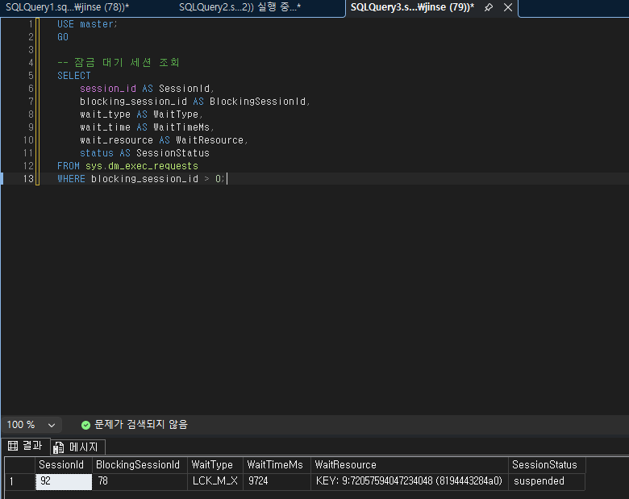
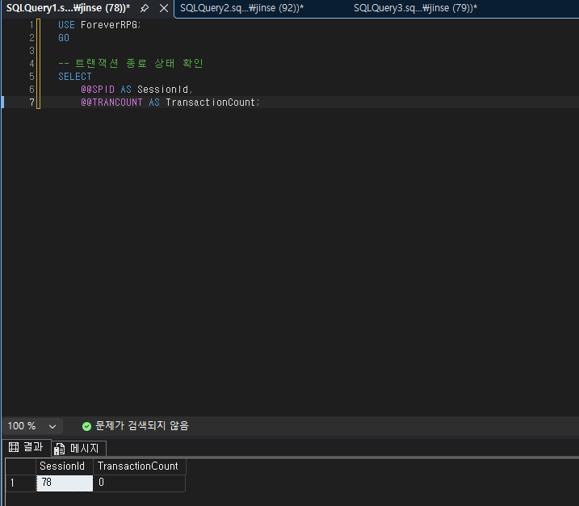
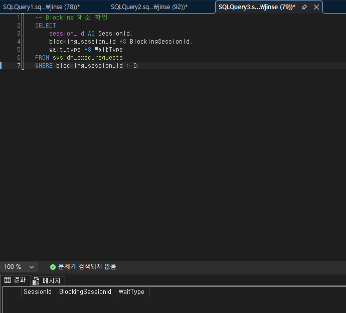

# 05-1. Blocking 장애 재현 및 대응

## 1. 작업 목적

Microsoft SQL Server에서 종료되지 않은 트랜잭션으로 인한 잠금 대기(Blocking)를 재현하고, 동적 관리 뷰(DMV)로 원인을 확인한 뒤 트랜잭션 종료와 대기 상태 해소를 검증했습니다.

실습은 로컬 Forever RPG 개발용 데이터베이스에서 진행했습니다.

## 2. 재현 조건

SSMS에서 세 개의 독립된 세션을 사용했습니다.

| 세션 | SPID | 역할 |
|---|---:|---|
| A | 78 | 캐릭터 골드 수정 후 트랜잭션 유지 |
| B | 92 | 같은 캐릭터에 UPDATE 실행, 잠금 대기 |
| C | 79 | DMV 조회 및 장애 상태 확인 |

세션 A에서는 `BEGIN TRAN` 이후 `Characters` 테이블의 `CharacterId = 1` 행을 UPDATE하고 트랜잭션을 종료하지 않았습니다. 세션 B에서 같은 행에 UPDATE를 시도하여 Blocking을 발생시켰습니다.

실습 SQL: [04_blocking_test.sql](../database/tests/04_blocking_test.sql)

## 3. 장애 감지 및 원인 분석

세션 B가 대기하는 동안 세션 C에서 `sys.dm_exec_requests`를 조회했습니다.

| 확인 항목 | 실측 결과 |
|---|---|
| 대기 중인 세션 | 92 |
| 차단 중인 세션 | 78 |
| 대기 유형 | `LCK_M_X` |
| 대기 시간 | 9,724ms |
| 요청 상태 | `suspended` |
| 대기 리소스 | `KEY` 잠금 |

`blocking_session_id = 78`을 통해 세션 92의 요청이 세션 78에 의해 차단되고 있음을 확인했습니다. `LCK_M_X`는 배타적 잠금 획득을 기다리는 상태이며, `suspended`는 요청이 대기 중임을 나타냅니다.

## 4. 장애 조치 — 트랜잭션 종료

세션 A에서 `ROLLBACK TRAN`으로 트랜잭션을 종료했습니다. 이후 해당 세션에서 `@@TRANCOUNT = 0`을 확인했습니다.

아래 화면은 트랜잭션 종료 **상태**의 증빙이며, `ROLLBACK` 명령 실행 자체가 표시된 화면은 아닙니다.

실제 운영 환경에서는 차단 세션의 작업 목적과 영향 범위를 먼저 확인해야 합니다. 운영 세션을 무조건 롤백하거나 강제 종료하는 것은 적절하지 않습니다.

## 5. 장애 해소 검증

세션 C에서 같은 DMV 쿼리를 다시 실행한 결과, `blocking_session_id > 0` 조건에 해당하는 행이 **0건**으로 조회됐습니다.

이는 **재조회 시점에** 차단된 요청이 관찰되지 않았음을 의미합니다. 모든 잠금이 존재하지 않는다는 뜻은 아닙니다.

## 6. 검증 범위 및 주의사항

- 세션 B의 UPDATE가 시간 초과 전에 완료됐다면 자동 커밋으로 골드가 실제 증가할 수 있습니다.
- `SET LOCK_TIMEOUT`은 기다리는 최대 시간을 제어하며, 잠금을 해제하지 않습니다.
- `@@TRANCOUNT = 0`은 해당 세션의 열린 트랜잭션이 없음을 보여줍니다.
- 이번 증빙은 Blocking 감지와 해소 확인에 집중했습니다. 데드락, 장애 자동 감지, 재시도 로직은 아직 검증하지 않았습니다.

## 7. 학습 결과 및 다음 작업

동일한 행을 수정하는 두 트랜잭션 사이에서 대기가 발생할 수 있으며, `sys.dm_exec_requests`의 `session_id`, `blocking_session_id`, `wait_type`을 사용해 차단 관계를 확인했습니다. 조치 이후에도 같은 관측 방법으로 정상화 여부를 재확인했습니다.

다음 단계에서는 데드락을 별도 시나리오로 재현하고 해결 절차를 비교할 예정입니다.

## AI 활용 및 직접 수행 범위

- **AI를 활용한 작업:** Blocking 재현을 위한 세션 A·B·C SQL 초안 및 DMV 조회 쿼리 안내, 보고서 구성
- **직접 수행한 작업:** SSMS에서 서로 다른 세션으로 잠금 대기 재현, `LCK_M_X`와 차단 세션 확인, 트랜잭션 종료 및 대기 해소 검증

세션 번호와 대기 시간은 AI의 가상 예시가 아니라 실습 화면에서 확인한 값입니다.
