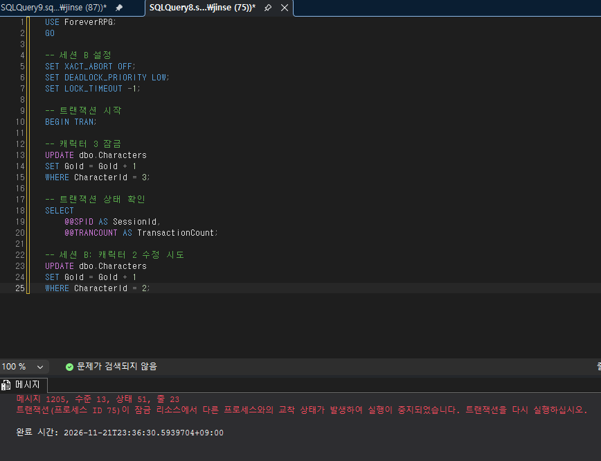
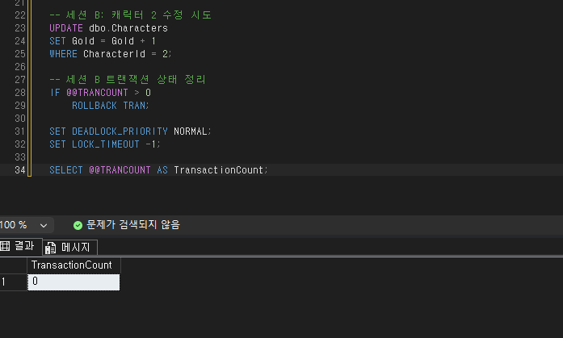
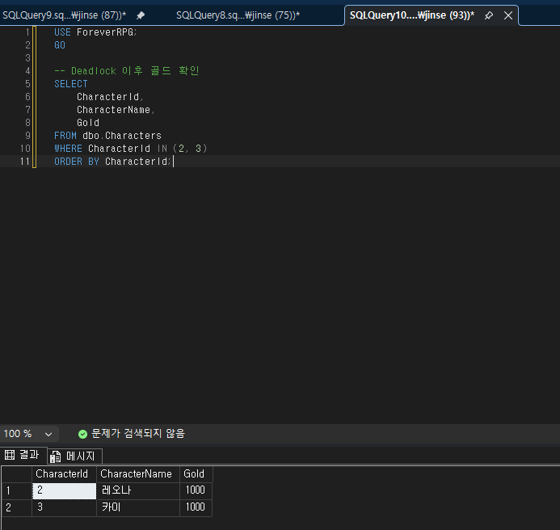

# 05-2. Deadlock 재현 및 원인 분석

## 1. 작업 목적

Microsoft SQL Server의 Deadlock(교착 상태)을 직접 재현하고, 오류 1205 및 `system_health` Extended Events에 기록된 Deadlock XML을 통해 발생 원인과 희생자 선정 근거를 확인했습니다.

실습은 `ForeverRPG` 개발용 데이터베이스에서 진행했습니다. 대상은 `Characters` 테이블의 캐릭터 2번과 3번입니다.

## 2. 재현 절차

각기 다른 두 SSMS 세션에서 트랜잭션을 시작하고, 행을 서로 반대 순서로 수정했습니다.

| 순서 | 세션 A (SPID 87) | 세션 B (SPID 75) |
|---|---|---|
| 1 | 캐릭터 2 UPDATE, 트랜잭션 유지 | — |
| 2 | — | 캐릭터 3 UPDATE, 트랜잭션 유지 |
| 3 | 캐릭터 3 UPDATE 시도, 대기 | — |
| 4 | 대기 유지 | 캐릭터 2 UPDATE 시도 |
| 5 | 대기 해소 후 진행 가능 | 오류 1205, Deadlock Victim |

세션 B에는 `SET DEADLOCK_PRIORITY LOW`를 적용했으며, A는 `NORMAL`로 설정했습니다.

재현 SQL: [05_deadlock_test.sql](../database/tests/05_deadlock_test.sql)

## 3. 오류 1205 확인

SQL Server가 교착 상태를 감지해 세션 B(SPID 75)를 희생자로 선택했습니다. 세션 B의 트랜잭션은 엔진에 의해 롤백됐습니다.

## 4. Deadlock XML 분석

`system_health`의 `xml_deadlock_report` 이벤트를 조회하고 XML의 `victim-list`, `process-list`, `resource-list`를 분석했습니다.

### 희생자 및 프로세스

| 분석 항목 | 세션 A | 세션 B |
|---|---|---|
| SPID | 87 | 75 |
| Deadlock 우선순위 | 0 (NORMAL) | -5 (LOW) |
| XML 대기 시간 | 18,111ms | 233ms |
| 대기 잠금 모드 | X | X |
| 상태 | suspended | suspended |
| 해당 시점 실행 SQL | `CharacterId = 3` UPDATE | `CharacterId = 2` UPDATE |
| 결과 | 희생자 아님 | 희생자 선정 |

`victim-list`에는 세션 B에 해당하는 프로세스 ID가 기록됐습니다. `priority="-5"`로 표시된 세션 B는 세션 A(`priority="0"`)보다 Deadlock 우선순위가 낮아 희생자로 선택됐습니다.

**주의:** `waittime`은 XML에 기록된 각 세션의 대기 시간이며, 전체 트랜잭션 실행 시간이나 장애 복구 시간을 뜻하지 않습니다. 희생자 선택을 대기 시간만으로 해석하면 안 됩니다.

### 잠금 관계

XML의 `resource-list`에는 `ForeverRPG.dbo.Characters`의 기본 키 인덱스에 속하는 두 개의 `keylock`이 기록됐습니다.

| 리소스 | 잠금 보유자(Owner) | 대기자(Waiter) |
|---|---|---|
| 캐릭터 2에 해당하는 키 | 세션 A (87), X | 세션 B (75), X |
| 캐릭터 3에 해당하는 키 | 세션 B (75), X | 세션 A (87), X |

양쪽 세션이 서로 상대방의 배타적 잠금을 기다리는 **순환 대기(Circular Wait)** 상태였다는 점이 교착 상태의 직접적인 근거입니다.

원본 XML에는 클라이언트 컴퓨터 및 계정 식별 정보가 포함되어 있어 공개 저장소에 원문 그대로 게시하지 않았습니다. 본 보고서에서는 진단에 필요한 세션·잠금·SQL 정보만 요약했습니다. Deadlock Graph 이미지는 추후 추가할 수 있습니다.

## 5. 트랜잭션 정리 및 데이터 검증

Deadlock 희생자의 트랜잭션은 SQL Server에서 자동 롤백되지만, 살아남은 세션의 트랜잭션은 별도로 종료해야 합니다.

세션 A와 B에서 열린 트랜잭션을 확인한 뒤 종료하고, `@@TRANCOUNT = 0` 여부와 캐릭터 2·3의 골드 값을 재확인했습니다.

## 6. 원인 및 예방 방안

**원인:** 두 트랜잭션이 동일한 행 집합을 반대 순서로 UPDATE하면서 서로의 배타적 잠금을 기다렸습니다.

**개선 방향:** 게임 내 복수 캐릭터 간 재화 이동 또는 교환 기능을 구현할 때, 대상 캐릭터의 잠금을 항상 동일한 ID 순서로 획득하도록 설계합니다. 또한 트랜잭션을 가능한 짧게 유지하고, 애플리케이션 계층에서 오류 1205 발생 시 작업 단위 전체를 안전하게 재시도하도록 구현할 수 있습니다. 재시도에는 제한 횟수와 멱등성 검토가 필요합니다.

해당 개선안은 이번 단계에서 설계 방향으로 제시했으며, 별도의 동시성 부하 테스트로 효과를 검증하지는 않았습니다.

## 7. 학습 결과

Blocking은 다른 세션의 잠금 해제까지 기다리는 상황인 반면, Deadlock은 둘 이상의 트랜잭션이 서로가 보유한 잠금을 기다리는 순환 관계입니다.

이번 실습에서는 오류 1205 재현, SQL Server의 희생자 선정, Deadlock XML 내 프로세스·잠금 관계 확인, 트랜잭션 종료 및 데이터 검증 과정을 수행했습니다.

## AI 활용 및 직접 수행 범위

- **AI를 활용한 작업:** Deadlock 재현 SQL과 분석 절차 안내, 제공된 Deadlock XML의 `victim-list`·`resource-list` 해석 지원 및 보고서 작성
- **직접 수행한 작업:** SSMS에서 교착 상태 재현, 오류 1205 확인, `system_health` 이벤트 조회, 트랜잭션 정리와 데이터 검증

AI가 실제 DB에 접속하여 교착 상태를 발생시킨 것은 아니며, 분석은 직접 수집한 XML과 스크린샷을 근거로 정리했습니다.
