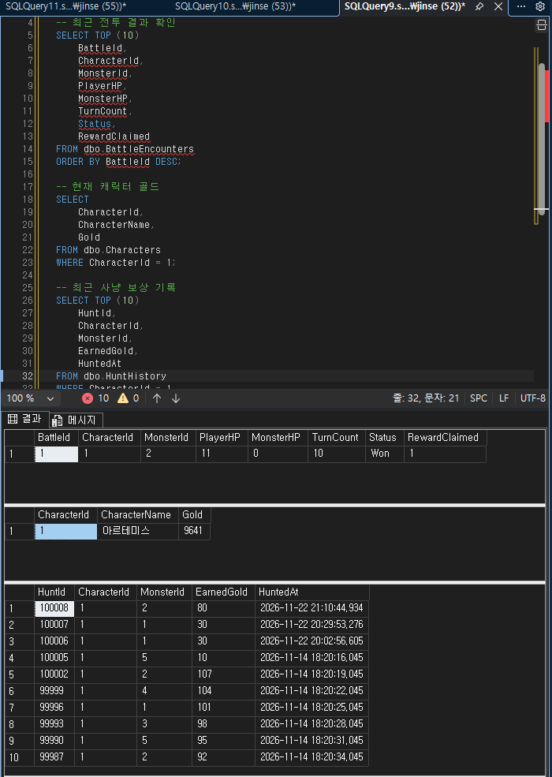
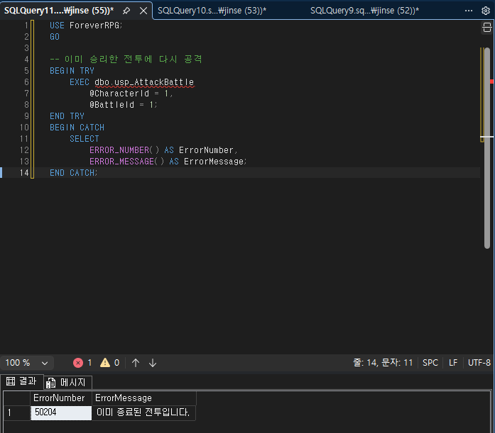
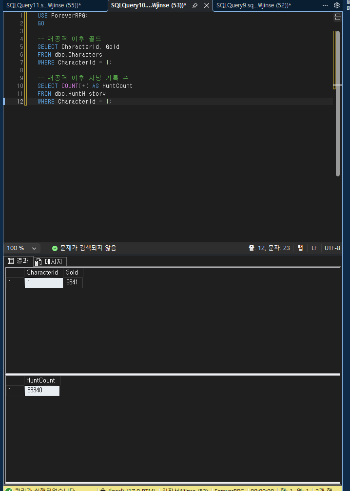

# 9일 차 — 턴제 전투 및 중복 보상 검증

## 1. 작업 목적

Forever RPG 웹 게임에서 시작한 전투를 SQL Server에 저장하고, 공격·승패 판정·보상 지급을 데이터베이스에서 처리하도록 구현했습니다. 승리 후 같은 전투에 대한 재공격이 골드 및 사냥 기록을 중복 변경하지 않는지도 검증했습니다.

## 2. 전투 처리 구조

웹 게임은 FastAPI로 요청을 전달하고, FastAPI는 아래 Stored Procedure를 호출합니다.

| 처리 | DB 객체 | 역할 |
|---|---|---|
| 전투 시작 | `usp_StartBattle` | 캐릭터와 몬스터 확인, `BattleEncounters` 생성 |
| 공격 실행 | `usp_AttackBattle` | HP 변경, 턴 증가, 승패 판정 |
| 승리 보상 | `usp_HuntMonster` | 승리 및 보상 미지급 상태 검증, 골드 지급, 사냥 이력 기록 |

V003 패치에서 `BattleEncounters` 테이블을 추가해 전투의 HP, 상태, 보상 지급 여부를 저장하도록 했습니다.

전투 시작과 공격은 각각 `POST /battle/start`, `POST /battle/attack` API를 통해 요청합니다. 기존처럼 전투와 무관하게 `POST /hunt`로 보상을 지급하는 API는 제거했습니다.

- [V003 전투 테이블 패치](../database/migrations/V003__add_battle_encounters.sql)
- [전투 시작 Stored Procedure](../database/procedures/usp_StartBattle.sql)
- [공격 Stored Procedure](../database/procedures/usp_AttackBattle.sql)
- [보상 지급 Stored Procedure](../database/procedures/usp_HuntMonster.sql)
- [전투 검증 SQL](../database/tests/07_battle_validation.sql)

## 3. 전투 승리 확인

실제 웹 게임에서 몬스터 사냥을 진행한 후 `BattleEncounters`의 전투 결과를 확인했습니다.

| 항목 | 실습 결과 |
|---|---|
| BattleId | 1 |
| CharacterId | 1 |
| MonsterId | 2 |
| PlayerHP | 11 |
| MonsterHP | 0 |
| TurnCount | 10 |
| Status | Won |
| RewardClaimed | 1 |

`MonsterHP = 0`과 `Status = Won`으로 승리 상태를 확인했으며, `RewardClaimed = 1`로 보상 처리 완료 상태를 확인했습니다.



## 4. 종료된 전투의 재공격 차단

이미 승리한 `BattleId = 1`에 대해 아래 SQL로 다시 공격을 시도했습니다.

```sql
BEGIN TRY
    EXEC dbo.usp_AttackBattle
        @CharacterId = 1,
        @BattleId = 1;
END TRY
BEGIN CATCH
    SELECT
        ERROR_NUMBER() AS ErrorNumber,
        ERROR_MESSAGE() AS ErrorMessage;
END CATCH;
```

종료된 전투에서는 `Status <> 'Active'` 조건에 따라 오류 50204(`이미 종료된 전투입니다.`)가 발생하도록 구현했습니다.



## 5. 데이터 유지 검증

재공격 전후의 캐릭터 골드와 `HuntHistory` 행 수를 비교했습니다. 실습 결과, 두 값은 유지됐습니다.

따라서 **이번 순차 재공격 시도에서는 추가 보상이나 사냥 이력이 발생하지 않았음**을 확인했습니다.



## 6. 정합성 설계와 검증 범위

`usp_AttackBattle`은 전투 행에 대한 잠금을 획득한 뒤 상태를 확인합니다. 몬스터 HP가 0이 되어 승리하면 같은 트랜잭션에서 `usp_HuntMonster`를 호출합니다. 해당 프로시저는 전투의 `RewardClaimed = 0` 상태를 확인하고 보상 지급과 사냥 이력 기록, 보상 처리 표시를 함께 변경합니다. 오류가 발생하면 트랜잭션은 롤백됩니다.

검증된 범위와 한계는 다음과 같습니다.

- **검증 완료:** 전투 승리 상태, 보상 완료 상태 및 종료된 전투의 순차 재공격 시 데이터 유지
- **미검증:** 동일 전투에 대한 동시 요청, 다중 인스턴스 부하, 네트워크 오류 재시도 및 실제 서비스 수준의 인증·권한
- 현재 `HuntHistory`에는 `BattleId`가 없어 특정 전투와 지급 이력을 직접 조인하는 검증은 아직 불가능합니다.
- 개발용 웹 게임은 로그인 기능이 없어 외부 서비스로 공개하기에 적합하지 않습니다.

## 7. 학습 결과 및 다음 작업

단순히 브라우저에서 보상 지급을 요청하는 구조에서 벗어나, 서버에서 관리하는 전투 상태에 따라 지급 여부를 결정하도록 변경했습니다. 이를 통해 DB 트랜잭션과 보상 지급 상태를 함께 관리하는 방법을 실습했습니다.

다음 단계에서는 구매·사냥·인벤토리·전투를 포함한 전체 통합 테스트와 문서 정리를 수행할 예정입니다.

## AI 활용 및 직접 수행 범위

- **AI를 활용한 작업:** Python FastAPI·pyodbc API 구현, JavaScript `fetch()` 요청·응답 처리 및 RPG 웹 화면 코드 작성, V003 전투 테이블·전투 프로시저 SQL 초안 작성
- **직접 수행한 작업:** SSMS에서 V003 및 프로시저 등록, 웹 게임에서 실제 전투 실행, `BattleEncounters` 조회, 종료된 전투 재공격과 골드·사냥 기록 유지 검증

**웹 화면 → FastAPI → SQL Server** 연동 코드는 AI를 활용해 구성했습니다. 반면 DB에 반영된 실제 승리·보상 결과와 재공격 검증은 사용자가 실행하여 확인했습니다. 순차 재공격과 동시 요청 검증은 구분하여 기록합니다.
